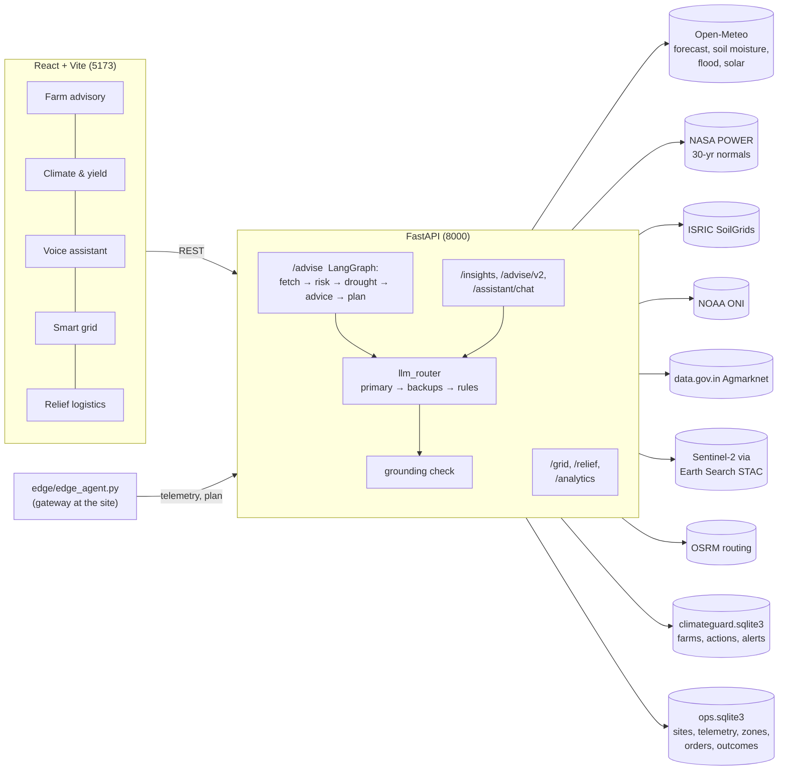

# ClimateGuard AI

**Climate, resource and supply-chain resilience for farmers, communities and local infrastructure.**

ClimateGuard AI turns live weather, soil, satellite, river and market data into plain-language, crop-level advice, micro-location climate risk, solar/water planning for local grids, and automated emergency-supply logistics. It is a FastAPI + React application built around one rule: **every number on screen comes from a live provider or from your own device telemetry. Missing data is labelled "unavailable", never replaced by a placeholder.**

---

## Contents

1. [What it does](#1-what-it-does)
2. [Architecture](#2-architecture)
3. [Data sources](#3-data-sources)
4. [Quick start](#4-quick-start)
5. [Configuration](#5-configuration-env)
6. [Using the application](#6-using-the-application)
7. [API reference](#7-api-reference)
8. [How the models work](#8-how-the-models-work)
9. [Reliability and graceful degradation](#9-reliability-and-graceful-degradation)
10. [Edge controller](#10-edge-controller)
11. [Testing](#11-testing)
12. [Project layout](#12-project-layout)
13. [Limitations and honest status](#13-limitations-and-honest-status)
14. [Security notes](#14-security-notes)
15. [Troubleshooting](#15-troubleshooting)
16. [Roadmap](#16-roadmap)
17. [Data licences and credits](#17-data-licences-and-credits)

---

## 1. What it does

The UI has five tabs. Each maps to a problem area in the *Climate, Resource Infrastructure & Global Supply Resilience* track.

| Tab | Problem area | What you get |
|---|---|---|
| **Farm advisory** | Multilingual agritech advisory | Saved farm profiles, 16-day forecast, heat / heavy-rain / waterlogging / drought indicators, AI advisory (English / Hindi), dated field-action plan, alerts with thresholds, SoilGrids soil estimates, Agmarknet mandi prices, 30-day weather history. |
| **Climate & yield risk** | Predictive micro-location engine | Click any point: four crop-specific hazard scores with evidence, 16-day rain / ET0 / temperature chart, irrigation need in mm, sowing and dry (harvest) windows, 5×5 risk heatmap over ~40 km, Sentinel-2 NDVI trend, ENSO state, AI advisory in 9 languages with a figure-verification badge. |
| **Voice assistant** | Multilingual conversational / voice assistant | Chat or speak a question in 9 languages. Answers use live data for the pinned location and crop, cite sources and are checked against the numbers. Read-aloud built in. |
| **Smart grid** | Smart-grid and urban resource controller | 24-hour plan for a clinic, pump station or micro-grid: solar forecast, heat-driven cooling demand, battery reserve, priority-based load shedding, delayed loads moved into solar hours, water-tank pump schedule. Includes a standalone edge agent. |
| **Relief logistics** | Emergency response and supply-chain swarm | Monitors weather and river forecasts per zone, finds supplier stock, plans the safest road using forecast rain along the route, assigns the nearest vehicle, creates and (where configured) dispatches orders, and logs every step. |

Supported languages for advice and voice: English, Hindi, Bengali, Marathi, Tamil, Telugu, Gujarati, Kannada, Punjabi. Interface labels are English and Hindi; other languages fall back to English labels.

---

## 2. Architecture



Design principles:

* **No invented data.** Provider failures become explicit `error` fields and warnings. A score whose inputs are missing is `null`, not 0.
* **Heuristic, labelled as such.** There is no trained ML model; every score is a transparent rule you can read in `risk_engine.py` / `climate_risk.py`.
* **Fail soft.** One slow or dead provider never takes down a whole response (see [section 9](#9-reliability-and-graceful-degradation)).
* **Two databases on purpose.** Your farm data (`climateguard.sqlite3`) is separate from operational data (`ops.sqlite3`) so neither can corrupt the other.

---

## 3. Data sources

| Provider | Used for | API key |
|---|---|---|
| [Open-Meteo](https://open-meteo.com) forecast | 16-day forecast, past 30 days, ET0, modelled soil moisture and soil temperature, hourly irradiance for solar | none |
| Open-Meteo flood API (GloFAS) | River discharge forecast, flood signal | none |
| Open-Meteo archive | 30-day weather history (reanalysis, not station data) | none |
| [NASA POWER](https://power.larc.nasa.gov) | 30-year monthly rainfall normals | none |
| [ISRIC SoilGrids](https://soilgrids.org) | Sand, clay, silt, SOC, pH, bulk density estimates (250 m) | none |
| [NOAA CPC](https://www.cpc.ncep.noaa.gov) ONI | El Niño / La Niña phase | none |
| [data.gov.in](https://data.gov.in) Agmarknet | Mandi prices | **`MANDI_API_KEY`** |
| Sentinel-2 L2A via Earth Search STAC | Cloud-masked NDVI time series | none |
| [OSRM](https://project-osrm.org) | Road routes with alternatives | none (public demo; self-host for production) |
| OpenStreetMap / CARTO / Esri | Map tiles (automatic fallback chain) | none |
| NASA GIBS | Optional MODIS satellite map layer | none |
| Gemini / Anthropic / Groq | AI advisory text | **`LLM_API_KEY`** (+ optional backups) |

---

## 4. Quick start

**Requirements:** Python 3.11, Node.js 18+, and (for NDVI) a platform where `pip install rasterio` works (wheels are provided for Windows, macOS and Linux).

### 4.1 Backend (Windows PowerShell)

```powershell
Copy-Item .env.example .env          # then open .env and add your keys
Set-Location .\backend
python -m venv ..\.venv ; ..\.venv\Scripts\Activate.ps1
python -m pip install -r requirements-dev.txt
python -m uvicorn app.main:app --reload
```

macOS / Linux:

```bash
cp .env.example .env
cd backend && python3.11 -m venv ../.venv && source ../.venv/bin/activate
pip install -r requirements-dev.txt
uvicorn app.main:app --reload
```

API docs: <http://localhost:8000/docs>

### 4.2 Frontend

```bash
cd frontend
npm ci
npm run dev          # http://localhost:5173
```

If the backend is not on `http://localhost:8000`, set `VITE_API_BASE_URL` (for example in `frontend/.env`). One variable controls every tab.

### 4.3 Docker development

```bash
docker compose up --build
```

This is the development setup: backend hot reload and Vite dev server with source mounts. Backend runs on 8000 and frontend on 5173. Database files are written under `backend/data/` through the source mount.

### 4.4 Production Docker Compose

```powershell
Copy-Item .env.example .env
# Add only the provider credentials you intend to use.
docker compose -f docker-compose.prod.yml up --build
```

The production frontend is served by Nginx on port 8080 and the API on 8000. Set `VITE_API_BASE_URL` before building if the browser reaches the API through a different origin. Persistent backend files use the named `backend-data` volume. Render/Vercel deployment instructions are in [DEPLOY.md](./DEPLOY.md).

### 4.5 First checks

1. Open `/health`: should return OK.
2. **Climate & yield risk** tab: click the map, press *Analyze*. Forecast, risk bars and the source-health line at the bottom of the risk card confirm which providers answered (`live`, `stale`, `unavailable`).
3. **Farm advisory** tab: the advisory badge shows whether text was written by an AI model (with provider name) or is a rule-based fallback.

---

## 5. Configuration (`.env`)

Copy `.env.example` to `.env`. Never commit `.env`.

| Variable | Default | Purpose |
|---|---|---|
| `CORS_ORIGINS` | `http://localhost:5173,http://127.0.0.1:5173` | Allowed browser origins |
| `DATA_DIR` | `backend/data` | Root directory for SQLite databases and disk caches |
| `CACHE_TTL` | `3600` | Seconds to cache provider responses (`DATA_DIR/cache.db`) |
| `HTTP_TIMEOUT` | `20` | Base provider timeout (fast providers are capped lower, slow portals get up to 28 s read) |
| `ADVISE_TIMEOUT` | `80` | Overall limit for one `/advise` run |
| `MANDI_API_KEY` | – | data.gov.in key for mandi prices |
| `MANDI_RESOURCE_ID` | Agmarknet daily-price resource | Override only if data.gov.in changes the resource |
| `LLM_PROVIDER` | `GEMINI` | Primary LLM provider; matches the config default and preserves the existing Gemini-first setup |
| `LLM_API_KEY` / `LLM_MODEL` | – / `gemini-2.5-flash` | Primary model |
| `LLM_BASE_URL` | – | For OpenAI-compatible servers (for example local Ollama) |
| `LLM_CONNECT_TIMEOUT`, `LLM_READ_TIMEOUT`, `LLM_WRITE_TIMEOUT`, `LLM_POOL_TIMEOUT` | `10`, `60`, `10`, `5` | LLM timeouts (read is capped at 15 s per call by design) |
| `OPENAI_API_KEY`, `OPENAI_MODEL` | – / `gpt-4o-mini` | Optional OpenAI backup and model |
| `ANTHROPIC_API_KEY`, `ANTHROPIC_MODEL` | – / `claude-haiku-5-5` | Backup provider |
| `GROQ_API_KEY`, `GROQ_MODEL` | – / `llama-3.1-8b-instant` | Backup provider |
| `GEMINI_API_KEY`, `GEMINI_MODEL` | – / `gemini-2.5-flash-lite` | Backup Gemini key (use a different Google project: quota is per project) |
| `OSRM_URL` | public demo server | Point to your own OSRM for real operations |
| `RELIEF_AUTOPILOT_MINUTES` | unset (off) | Let the relief agent run on its own every N minutes |
| `RELIEF_MIN_LEVEL` | `high` | Hazard level that triggers autopilot (`watch`, `high`, `severe`) |
| `OPS_DB` | `DATA_DIR/ops.sqlite3` | Optional explicit location for the operations database |
| `ADMIN_TOKEN` | unset | Optional `X-Admin-Token` check on selected grid/relief writes and farm deletion |
| `RATE_LIMIT_PER_MIN`, `RATE_LIMIT_HEAVY_PER_MIN` | `120`, `20` | In-process per-client rate limits |
| `TRUST_PROXY` | `0` | Trust `X-Forwarded-For` only behind a trusted reverse proxy |
| `MAX_REQUEST_BODY_BYTES` | `1048576` | Maximum JSON request body; voice audio retains its route-level cap |
| `ALLOWED_SUPPLIER_HOSTS` | unset | Optional comma-separated supplier URL hostname allow-list |
| `GNANI_API_KEY`, `SARVAM_API_KEY` | unset | Optional voice and translation providers |
| `VITE_API_BASE_URL` | `http://localhost:8000` | Frontend → backend URL |

**Which keys do I need?** `LLM_API_KEY` enables AI advisories; `MANDI_API_KEY`, `GNANI_API_KEY`, and `SARVAM_API_KEY` enable their respective optional integrations. If Gemini reaches quota, set `OPENAI_API_KEY` for OpenAI failover. Provider availability and model access depend on each account.

---

## 6. Using the application

### 6.1 Farm advisory

1. Click the map or enter coordinates; choose the crop and language.
2. Save a **farm profile** (name, location, crop, growth stage, planting date, area, soil and irrigation type) to get persisted actions and alerts.
3. Read the risk cards. A card shows *Unavailable* when its inputs could not be fetched; it never shows 0 for missing data.
4. The **field plan** lists dated actions. The same action on consecutive days is merged into one entry with an end date.
5. **Alerts**: set the threshold and save preferences. Alerts are de-duplicated per hazard, level and week.

### 6.2 Climate & yield risk

Pick a crop, optionally a growth stage (flowering and grain-filling lower the heat threshold by 2 °C), soil type (used if SoilGrids has no value) and state (for mandi prices), then **Analyze**.

* **Risk with evidence**: each hazard lists the exact figures and which source (S1–S6) they came from.
* **Heatmap layer**: overall, heat, heavy rain or 7-day water deficit across a 5×5 grid.
* **Vegetation (NDVI)**: *Check vegetation* reads recent Sentinel-2 scenes (cloudy ones are skipped).
* **Report what happened**: record whether a drought, flood, heat stress or nothing occurred. These reports are the only way the scores can ever be validated.

### 6.3 Voice assistant

Press **Speak** and ask in your language, or type. Replies are read aloud (toggle at the bottom). Voice uses the browser's built-in speech recognition and synthesis (Chrome or Edge recommended). Each reply shows which engine wrote it and how many figures matched the data.

### 6.4 Smart grid

1. Place the site on the map, enter solar capacity, battery size and reserve, inverter limit, grid import limit and (optionally) water tank and pump details.
2. Add **loads** with a priority (P1 life-critical … P5 first to shed), tick *Cooling load* if demand rises with temperature, tick *Can be delayed* with run-hours for deferrable loads.
3. **Send readings** (battery %, tank %, grid status) from your devices, or let the edge agent do it.
4. **Plan next 24 h**: recommendations, warnings, energy chart and a schedule that moves delayed loads into solar hours.

### 6.5 Relief logistics

1. Click the map to choose a location, then add **zones** (communities with needs), **suppliers** (with a live inventory API URL, or manual stock, and an optional dispatch webhook) and **vehicles**.
2. **Check hazards now** shows each zone's level and the reasons.
3. **Run response cycle**. Keep *Dry run* ticked to see what the agent would do without contacting anyone or reserving stock.
4. Read the agent log, see the chosen routes on the map, and mark orders delivered when done.

---

## 7. API reference

Interactive documentation: `/docs`. Selected endpoints:

### Farm advisory (original)

| Method | Path | Purpose |
|---|---|---|
| GET | `/health` | Health check |
| POST | `/advise` | LangGraph run: weather + soil + mandi → risk → advice → field plan. Returns `advice_status` (`generated` / `fallback` / `unavailable`) and `advice_provider`. |
| GET, POST | `/farms` | List / create farm profiles |
| GET, PATCH, DELETE | `/farms/{id}` | Read / update / delete a farm |
| GET | `/farms/{id}/actions`; PATCH `/actions/{id}` | Field actions and status |
| GET | `/alerts`; PATCH `/alerts/{id}` | Alerts and read status |
| GET, PUT | `/farms/{id}/alert-preferences` | Alert settings |
| GET | `/history/weather` | 30-day reanalysis history |
| GET | `/analytics/model-status` | Model and validation status |
| GET | `/satellite/status` | Whether NDVI is available (checks `rasterio`) |

### Micro-location and advisory (new)

| Method | Path | Purpose |
|---|---|---|
| GET | `/insights/risk?lat&lon&crop&stage&soil_type&state` | Full assessment: risks with evidence, irrigation mm, sowing/dry windows, action plan, soil, ENSO, market, source health |
| GET | `/insights/grid?lat&lon&span_km&n` | Crop-agnostic hazard heatmap cells |
| GET | `/satellite/ndvi?lat&lon&days&half_km` | Cloud-masked Sentinel-2 NDVI series with trend |
| POST | `/advise/v2` | Assessment + AI advisory in 9 languages + alerts |
| POST | `/assistant/chat` | Conversational answer with history, grounding report and provider |

### Operations (new)

| Method | Path | Purpose |
|---|---|---|
| POST, GET | `/grid/sites`; DELETE `/grid/sites/{id}` | Define sites |
| POST | `/grid/telemetry`; GET `/grid/telemetry/{site}` | Post / read device readings |
| GET | `/grid/plan/{site}?hours&outage_hours` | 24–48 h plan. Telemetry older than 3 h is ignored and the response says so. |
| POST, GET | `/relief/zones`, `/relief/suppliers`, `/relief/fleet` | Register zones, suppliers, vehicle positions |
| DELETE | `/relief/{zones\|suppliers\|fleet}/{id}` | Remove an entry |
| GET | `/relief/hazards` | Current hazard level per zone |
| POST | `/relief/run` | Run one agent cycle `{min_level, dry_run}` |
| GET | `/relief/runs`, `/relief/orders`; PATCH `/relief/orders/{id}` | Audit log, orders, mark delivered/cancelled |
| POST | `/analytics/outcomes` | Report an observed outcome for validation |
| GET | `/analytics/validation` | Counts and (when enough labels exist) Brier score, AUC, reliability |

#### Supplier contract

* **Inventory API** (optional): `GET` returning `{"items":[{"item":"water","qty":500}]}` or `{"water":500}`.
* **Dispatch webhook** (optional): `POST` with the order JSON (id, zone, supplier, items, vehicle, route, hazard). Any 2xx means `dispatched`. Without a webhook the order stays `ready_to_dispatch`.

---

## 8. How the models work

All of this is rule-based and inspectable.

### 8.1 `/advise` risk engine (`services/risk_engine.py`)

* **Heat wave** = (forecast max °C − 28) × 7.25, clamped to 0–100.
* **Heavy rain / flood** = the larger of total forecast rain × 2.5 and (heaviest single day ÷ 115.6 mm) × 100, where 115.6 mm is the IMD "very heavy rain" lower bound.
* **Waterlogging** (needs a daily rainfall series) = wettest 3-day total ÷ (1.25 × the crop's tolerance in mm), with tolerance reduced on high-clay soils.
* **Drought** = from `services/drought.py` (below). Shown as unavailable if its inputs fail.
* **Overall** = the highest available score. Category: ≥ 75 high, ≥ 40 moderate, else low.

### 8.2 Crop-aware engine (`services/climate_risk.py`, used by `/insights/*`)

* Inputs: 16-day forecast plus 30 days of history, modelled soil moisture (0–28 cm), soil temperature, ET0, NASA 30-year monthly normal, GloFAS discharge, SoilGrids clay.
* **Soil water**: wilting point = 0.035 + 0.0045 × clay %, field capacity = 0.11 + 0.0065 × clay % (clay defaults to 20 % and is flagged "assumed" if unknown). Available water % = (θ − wilting) ÷ (capacity − wilting).
* **Drought** blends soil-water stress (40 %), 30-day rainfall deficit vs normal (25 %) and unmet crop demand over 14 days (35 %). Demand = ET0 × crop coefficient (Kc); only 80 % of rain counts as effective.
* **Heat**: days at or above the crop's stress temperature, plus the hottest day's margin. **Flood**: 3-day rain vs crop tolerance, or river discharge vs its 60-day median. **Unseasonal rain**: forecast excess over the 30-year normal.
* **Irrigation need** (mm per week) = ET0 × Kc − 0.8 × rain. **Sowing windows**: days when soil temperature is inside the crop range, 3-day rain ≤ 25 mm, heat below threshold + 3 °C and soil moisture in range. **Dry windows**: ≥ 3 days with ≤ 1 mm rain and low rain probability.
* Levels: < 25 low, < 50 moderate, < 75 high, else severe.
* Crop parameters (`crop_profiles.py`) are general agronomic rules of thumb for 11 crops, **not** local recommendations.

### 8.3 AI advisory, failover and the figure check

1. The prompt contains only data returned by providers and tells the model to cite sources and never invent figures.
2. `llm_router` tries the primary provider, then backups. A provider that returns 429 or 5xx is paused (cooldown, respecting `Retry-After`) so quota is not hammered. Identical requests are cached for 30 minutes.
3. `grounding.py` extracts every number with a unit (mm, °C, %, ₹) from the answer and verifies it against the data given to the model. If any figure is unmatched, the model gets **one** self-correction round; the badge reports the final match count.
4. If every model fails, a rule-based summary is shown and **labelled as such**. It is never presented as AI-generated.

### 8.4 Smart-grid planner (`services/gridctl.py`)

Pure Python, O(hours × loads), suitable for edge hardware.

* **PV**: kWp × irradiance ÷ 1000 × 0.80 performance ratio, de-rated 0.4 %/°C above 25 °C cell temperature, capped by the inverter.
* **Cooling loads** scale from 10 % duty at 26 °C to 100 % at 38 °C. **Heat wave** flags at ≥ 40 °C (watch) and ≥ 45 °C (severe).
* **Dispatch per hour**: PV first, then grid (up to the import limit), then battery. Loads are served in priority order. Non-critical loads cannot use the battery below the configured reserve; priority-1 loads may go down to 5 %. Round-trip losses use 92 % one-way efficiency.
* **Deferrable loads** are placed into the hours with the most surplus PV inside their allowed window.
* **Water**: demand rises 3 % per °C above 30 °C; if the tank would fall below 20 %, a pump load is scheduled for the needed hours.
* **Unknown state is never invented**: with no fresh telemetry the plan excludes the battery or tank and says so.

### 8.5 Relief logistics agent (`services/swarm.py`)

Loop: **observe → plan → route → act → recover.**

* **Hazard levels per zone**: rain ≥ 35 mm/24 h watch, ≥ 64.5 high, ≥ 115.6 severe (IMD classes); max temperature ≥ 40 / 45 / 47 °C; river discharge ≥ 2× / 3× / 5× its 60-day median.
* **Sourcing**: for each need, suppliers are tried nearest first. Stock comes from the supplier's live inventory API or from manually maintained stock (reserved when an order is made).
* **Routing**: OSRM returns up to 3 routes. Each is sampled about every 10 km and the forecast rain at those points is checked. Cost = hours + 6 per high-rain point + 24 per severe point. Any severe point makes a route unsafe.
* **Recovery**: unsafe route, empty stock or routing failure → next supplier. Unmet quantities are reported. Orders already open for a zone and item are not duplicated.
* **Dispatch**: nearest available vehicle, then the supplier webhook with one retry. Without a webhook, status is `ready_to_dispatch`.
* **Audit**: every step is stored with its stage, message and success flag.

### 8.6 Validation (`services/validation.py`)

Every assessment is logged. Users report outcomes (including "nothing happened"). A report is matched to the latest forecast issued 1–14 days earlier within 20 km. Brier score, AUC and a reliability table are computed per hazard only when at least 30 labelled outcomes with 5+ events and 5+ non-events exist. Until then the status reports how many labels are missing.

---

## 9. Reliability and graceful degradation

* **Per-provider budget**: each provider branch in `/advise` has its own 28 s limit; a timeout becomes an error message for that panel only.
* **Retries and caching**: bounded retries; forecast cached 15 min, soil 7 days, climate normals 30 days, mandi 1 h plus a 30-day stale copy that is shown with a clear warning if the portal is down.
* **Source-health report**: `/insights/risk` returns `live`, `stale` or `unavailable` for every source, with latency.
* **Partial results**: if soil, river, market or ENSO fail, the assessment still returns with warnings. Only the core forecast is mandatory (HTTP 503 with a plain explanation if it is down).
* **Input validation**: latitude/longitude ranges, unknown crops (422), future observation dates (422).
* **Map tiles**: switches to a second and third tile provider if the first blocks or fails.
* **Edge agent**: keeps operating offline (see below).

---

## 10. Edge controller

`edge/edge_agent.py` runs on a gateway beside the inverter, battery and pumps. Standard library only.

```bash
python edge_agent.py --server http://192.168.1.10:8000 --site clinic \
    --sensor-cmd "python read_inverter.py" \
    --actuator-cmd "python apply_relays.py" \
    --interval 300
```

* `--sensor-cmd` must print JSON such as `{"soc_pct": 62, "tank_pct": 41, "load_kw": 3.2, "grid_available": true}`. You write this small adapter for your hardware (Modbus, serial, GPIO, a data logger file…).
* `--actuator-cmd` receives the current hour's decision as JSON on stdin: loads to shed and deferrable loads to run.
* If the server is unreachable it reuses the cached plan for up to 6 hours, then applies a local fail-safe (shed priority ≥ 3 loads when the battery is at or below its reserve).
* If the sensor command fails it posts nothing and **leaves the actuators unchanged**.

---

## 11. Testing

```bash
cd backend
python -m pytest tests -q
```

The suite covers the risk engines (including the original pinned values), LLM timeouts and failover, graph provider budgets, persistence, field planner, grid planner (heat, battery, water, unknown state), the relief agent, URL security, rate limiting, optional write protection, and API endpoints with simulated provider failures. Live-provider tests are opt-in.

Test fixtures with synthetic numbers exist **only** in `tests/`; the application never uses them.

Frontend: `npm run build` must succeed. Voice and live provider calls need manual checks on your machine.

---

## 12. Project layout

```
backend/
  app/
    main.py                 FastAPI app, /advise, farms, alerts, history, status
    config.py               Environment settings
    agent/                  LangGraph pipeline (graph.py) and prompts
    routers/
      insights.py           /insights/*, /satellite/ndvi, /advise/v2
      ops.py                /grid/*, /relief/*, /assistant/chat, /analytics/*
    services/
      risk_engine.py        /advise risk scores
      climate_risk.py       Crop-aware engine for /insights
      drought.py            Soil-moisture drought indicator for /advise
      crop_profiles.py      11 crops: Kc, heat limit, sowing range, waterlogging
      weather_service.py, history_service.py, soil_service.py, mandi_service.py   /advise providers
      live_data.py, soil_live.py, mandi_live.py, satellite_service.py             /insights providers
      llm_router.py, advisory_service.py, grounding.py                            AI + guardrails
      field_planner.py, action_planner.py, alert_engine.py                        Action plans, alerts
      gridctl.py, swarm.py, validation.py, ops_store.py                           Operations modules
    persistence/            SQLite farm, action and alert storage
    models/, utils/         Pydantic models, cache, retry, HTTP timeouts
  tests/
  data/                     climateguard.sqlite3, ops.sqlite3 (created at runtime)
frontend/
  src/Root.jsx              Tab shell + shared language
  src/App.jsx               Farm advisory tab
  src/components/           Panels (Climate, Assistant, Grid, Relief) and shared UI
  src/i18n/                 en.json, hi.json, ops.js
  src/api.js, api/insights.js
edge/edge_agent.py          Gateway agent (stdlib only)
docker-compose.yml           Development Compose
docker-compose.prod.yml      Production Compose
render.yaml, DEPLOY.md
```

---

## 13. Limitations and honest status

* **Not validated crop-loss models.** Scores are heuristic indicators, not calibrated probabilities. No labelled yield or loss data exists in the project, so no ML model is trained. The validation pipeline can only measure accuracy once users have reported enough outcomes.
* **Soil moisture is modelled** (Open-Meteo / ERA5-Land), not measured. SoilGrids values are estimates, and may be missing in built-up or water pixels.
* **NDVI** is an average over a 1 km box, not a single field, and cloudy scenes are skipped.
* **Crop parameters** are generalised; confirm costly actions with your local Krishi Vigyan Kendra.
* **Forecast hazard along routes** is rainfall only. It does not know about road closures, bridges or traffic.
* **Mandi prices** depend on what data.gov.in publishes that day; nothing is estimated.
* **Grid planner** is a transparent rule-based dispatcher, not a mathematical optimiser, and it has no built-in demand history: you describe loads yourself.
* **Voice** relies on the browser's speech features; Indian-language voices vary by device. It is not a phone / IVR service.
* **Interface labels** are English and Hindi only.
* Verified in development: unit tests, API tests with simulated failures, frontend build and a simulated-browser test of every tab. External provider access and hosted deployment still need to be verified in the target accounts.

---

## 14. Security notes

* **There is no general authentication or user isolation.** `ADMIN_TOKEN` is optional and only protects selected grid/relief writes and farm deletion; it does not secure every endpoint or provide per-user access control.
* Supplier inventory and webhook URLs are validated at registration and fetch time; non-public addresses and redirects are blocked, and response size/time are bounded. Set `ALLOWED_SUPPLIER_HOSTS` to narrow outbound destinations. Validation is not DNS pinning and cannot fully eliminate DNS rebinding races.
* Rate limiting is in-process and per instance. It is not coordinated across replicas and is not a replacement for a WAF, edge limiter, or account-level quotas. `X-Forwarded-For` is ignored unless `TRUST_PROXY=1`; only enable that behind a trusted proxy.
* Configure exact `CORS_ORIGINS`; wildcard CORS is rejected while credentials are enabled. CORS is not authentication.
* Persistent storage depends on `DATA_DIR` being mounted to durable storage. Render free instances use ephemeral storage; use a paid disk-backed service for persistent SQLite data.
* Keep `.env` out of version control and rotate any key that has been shared.
* Provider keys are backend-only and must never be copied into Vercel frontend variables. The application logs credential presence only in production, not secret values.

---

## 15. Troubleshooting

| Symptom | Cause and fix |
|---|---|
| App will not start with `cannot import name 'compute_risk'` | A file named `risk_engine.py` was overwritten. Restore it from this repository. |
| Advisory badge says *rule-based summary* | No LLM answered. Check `LLM_API_KEY`; Gemini HTTP 429 means quota is used up. Add a backup key (`ANTHROPIC_API_KEY` or `GROQ_API_KEY`) or wait. The reason for each skipped provider appears under the advisory. |
| Market panel says unavailable | Set `MANDI_API_KEY`. A timeout means data.gov.in is slow; the last real prices are shown with a warning if any were saved. |
| Soil panel says no values | SoilGrids has no data for that pixel; the app tries two neighbouring pixels, then your farm's soil type. Rate limits clear after a minute. |
| NDVI returns 501 | `pip install rasterio numpy`. |
| NDVI says no cloud-free scenes | Increase *days* or try again after the cloudy spell. |
| Map shows a blue grid or blank tiles | Hard-refresh. The app switches tile providers after 6 failed tiles; check that your network allows the tile servers. |
| Microphone button disabled | Use Chrome or Edge over `localhost` or HTTPS and allow microphone access. |
| Relief agent made no orders | Check the log: it states if zones, suppliers or stock are missing, or if every route crosses severe rain. |
| Grid plan ignores the battery | No telemetry in the last 3 hours (or no `soc_pct`); send readings. |

---

## 16. Roadmap

* Integrate the new risk panels into the main Farm advisory tab and add per-field polygons for NDVI.
* Gnani (or similar) Indian-language speech-to-text and text-to-speech behind server-side endpoints, keeping browser speech as fallback.
* Authentication, roles and a URL allow-list for the operations endpoints.
* SMS / WhatsApp alert delivery.
* Calibrate scores and train models once enough outcome reports or official loss data are available.
* Road-closure and traffic data in routing; optimisation-based dispatch for the grid planner.
* UI translations beyond English and Hindi.

---

## 17. Data licences and credits

Open-Meteo (CC BY 4.0; the free API is for non-commercial use), NASA POWER, ISRIC SoilGrids (CC BY 4.0), NOAA CPC, Copernicus Sentinel-2 (free and open), OpenStreetMap contributors (ODbL), OSRM, CARTO, Esri, NASA GIBS, and the Open Government Data Platform India for Agmarknet. Please check each provider's current terms before commercial use and keep the attributions that the map and data displays carry.
